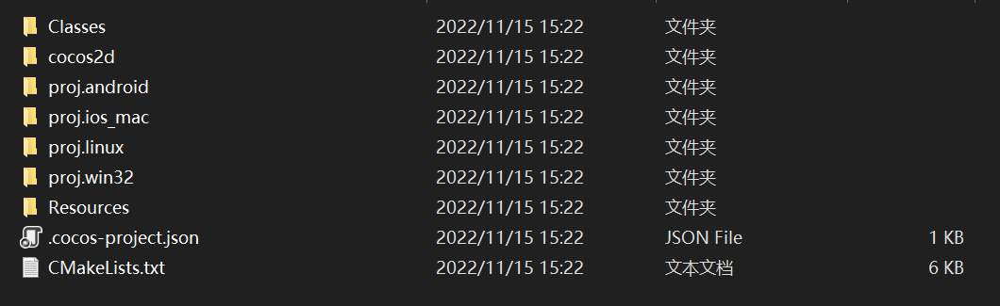
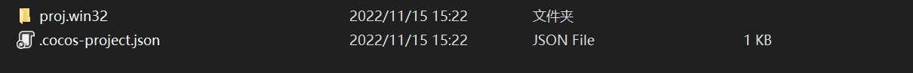
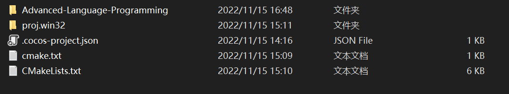
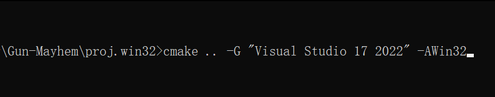
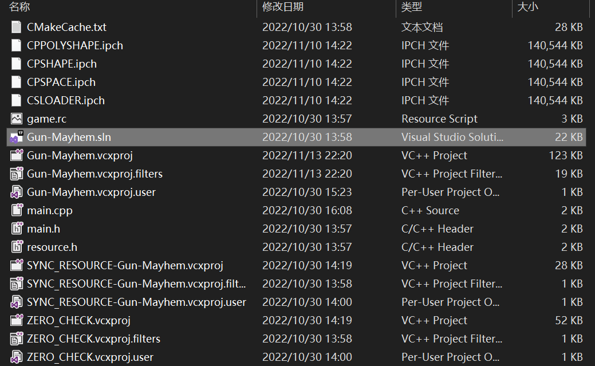

## Setup

1. 环境依赖：

   

   - 下载开发引擎：Cocos2d-x 4.0: https://www.cocos.com/cocos2dx-download

   - python2.7（用于编译Cocos2d-x，python3会报警告）：https://www.python.org/downloads/release/python-2718/

   - cmake (用于编译项目）：https://cmake.org/download/#latest

   - git （用于从github下载仓库的代码）

   - Visual Studio 2022 (IDE)

     

2. 新建一个项目:

   

   

   删除掉不需要的文件，留下两个文件`proj.win32`和`.cocos-project.json`

   

   

3. 使用当前项目文件：

   在项目根目录打开 `git Bash`。本项目已经包含 `cocos2d`、`Classes`、`Resources` 和构建配置，无需从其他仓库复制文件或目录。

   如果你是从本地压缩包开始，请先将整个项目解压到一个路径中，再从该项目根目录执行构建命令。

   

4. 构建项目：

   在项目文件 `proj.win32`  路径下进入 `cmd` ，输入 `cmake` 指令，指令在仓库中的 `cmake.txt` 文件中，生成解决方案 `sln`

   

   